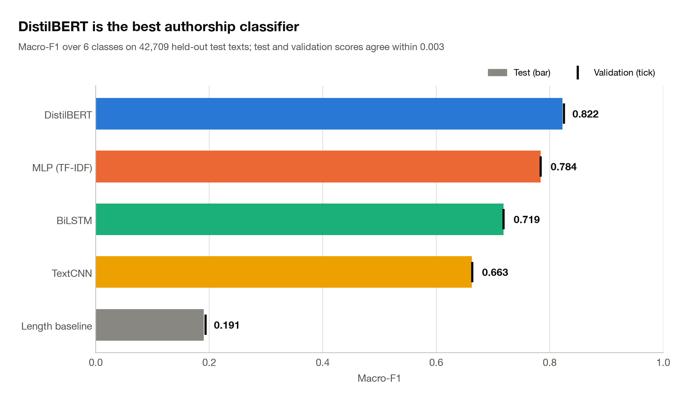
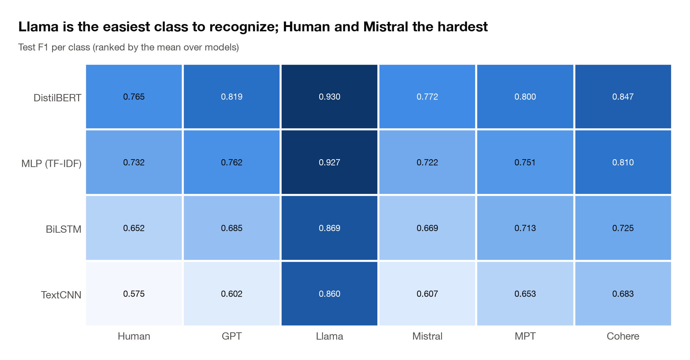
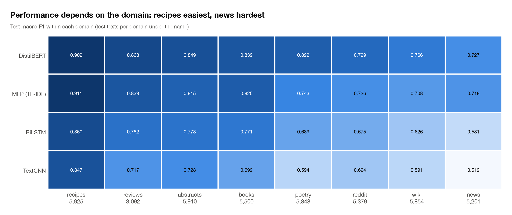
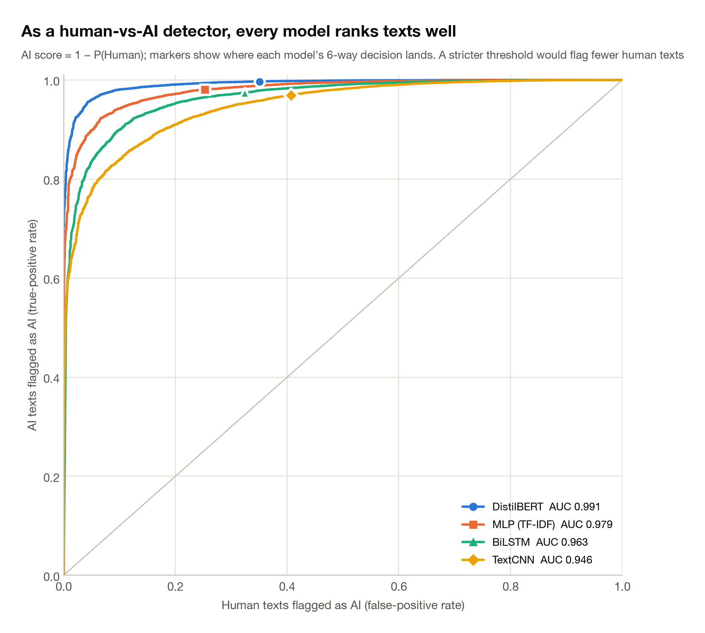
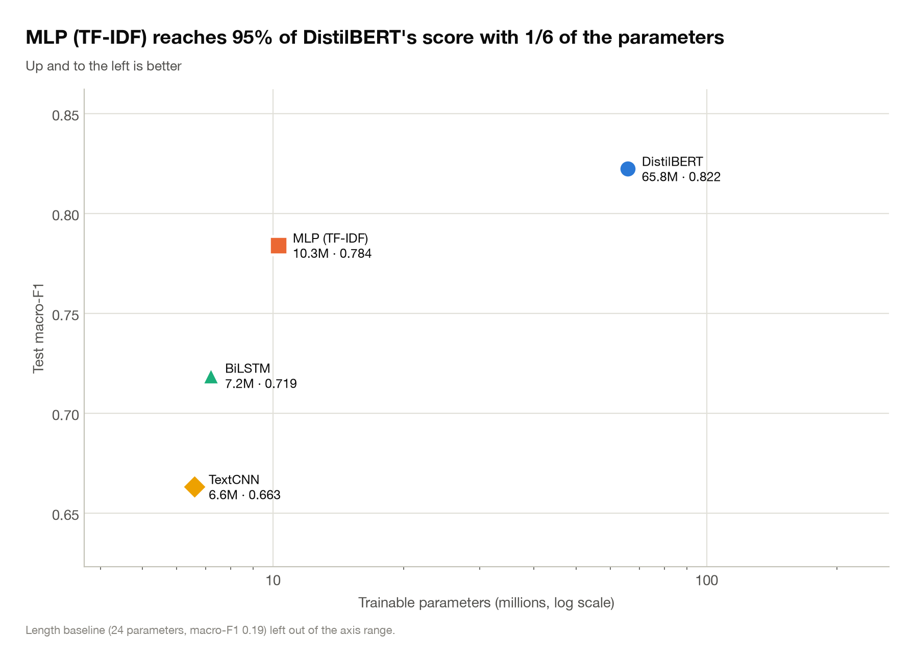

# Who Wrote This? Attributing Text to Humans and Five LLM Families

**The Turing Detectives** · CAP 5610 Machine Learning · University of Central Florida · Fall 2026
Instructor: Dr. Mengxin Zheng · Team: Vedith Reddy Kommula, Shresta Reddy Saireddy


Given a passage of text, can a model tell **who wrote it**, a person or a specific family of large
language models? This project frames the question as **six-way authorship attribution**
(Human, GPT, Llama, Mistral, MPT, Cohere) on the RAID benchmark and compares four neural
architectures under one controlled protocol: an **MLP on TF-IDF features**, a **TextCNN**, a
**BiLSTM** and a fine-tuned **DistilBERT**. Every model sees the same data, the same frozen splits, the
same class weights, the same random seed and the same evaluation code, so the differences
between them come from the architectures alone.

## Contents

- [Key results](#key-results)
- [Findings](#findings)
- [Task and data](#task-and-data)
- [Models](#models)
- [Experimental protocol](#experimental-protocol)
- [Reproducing the results](#reproducing-the-results)
- [Repository layout](#repository-layout)
- [Engineering notes](#engineering-notes)
- [Limitations and future work](#limitations-and-future-work)
- [Acknowledgments](#acknowledgments)

## Key results

All numbers are on the held-out **test set of 42,709 texts**, which was scored exactly once,
after all tuning had finished. Validation scores agree with the test scores to within 0.003.

| Model | Test macro-F1 | Accuracy | Human FPR ↓ | Human-vs-AI AUC | Parameters | Training time |
|---|---:|---:|---:|---:|---:|---:|
| **DistilBERT (fine-tuned)** | **0.822** | **0.830** | 0.350 | **0.991** | 65.8 M | 9 min (A100 GPU) |
| MLP on TF-IDF | 0.784 | 0.791 | **0.253** | 0.979 | 10.3 M | 11 min (laptop) |
| BiLSTM | 0.719 | 0.727 | 0.324 | 0.963 | 7.2 M | 140 min |
| TextCNN | 0.663 | 0.674 | 0.407 | 0.946 | 6.6 M | 14 min |
| Length-only baseline | 0.191 | 0.230 | 0.747 | 0.582 | 24 | 4 s |

*Macro-F1 averages the F1 of the six classes, so every author counts equally regardless of
class size. Human FPR is the share of human-written texts that a model attributes to any AI
family (lower is better). Human-vs-AI AUC treats each model as a binary detector with the
score 1 − P(Human).*

<p align="center">
  
</p>

## Findings

1. **Pretrained language understanding wins.** Fine-tuned DistilBERT is the strongest model
   on every class and every domain, at 0.822 macro-F1.
2. **A simple model comes close.** The MLP on word and character n-grams reaches 95% of
   DistilBERT's score with one-sixth of the parameters, trains on a laptop, and wrongly flags
   the fewest human texts as AI (25% vs 35%).
3. **The families have distinct fingerprints.** Llama is recognized almost perfectly
   (F1 0.93), while Human and Mistral are the hardest classes. Most confusions happen among
   Mistral, MPT and GPT, and missed human texts are most often mistaken for Cohere.
4. **As a plain AI detector, every model ranks texts well** (AUC 0.95–0.99). The high human
   false-positive rate comes from the six-way decision rule, not from weak scores: a stricter
   threshold would accuse far fewer people.
5. **The domain matters.** Recipes and reviews are easiest (DistilBERT macro-F1 up to 0.91),
   while news and Wikipedia are hardest (0.73–0.77).
6. **The choice of architecture matters more than tuning.** Hyperparameter search moved
   validation macro-F1 by at most 4 points within a model; the architecture moved it by 16.
7. **The models make different mistakes.** Any two models share only 30–39% of their
   errors, which suggests that an ensemble could improve on the best single model.

<p align="center">
  
</p>

<p align="center">
  
</p>

<table>
  <tr>
    <td></td>
    <td></td>
  </tr>
</table>

The full set of 29 figures (dataset statistics, confusion matrices, precision-recall curves,
learning and loss curves, tuning runs, calibration, confidence and model agreement) is generated
by `python -m src.analysis.figures`.

## Task and data

**Dataset.** [RAID](https://raid-bench.xyz/) (Dugan et al., ACL 2024), the clean, non-attacked
labeled split `train_none`. Only the `generation` column (the passage itself) is used as model
input. Columns that would leak the label, such as the prompt, the title, the decoding strategy and the attack
type, are never used as features.

**Labels.** The generator names in RAID are grouped into six classes:

| Class | RAID generators |
|---|---|
| Human | human |
| GPT | gpt2, gpt3, chatgpt, gpt4 |
| Llama | llama-chat |
| Mistral | mistral, mistral-chat |
| MPT | mpt, mpt-chat |
| Cohere | cohere, cohere-chat |

**Pipeline** (`src/data/build_splits.py`, run once; the splits are then frozen):

1. **Clean.** Zero-width characters are removed and whitespace is stripped, for the checks
   only; the models see the original text. Then the pipeline drops empty texts and texts
   under 10 words. Duplicate texts written by different families are all removed, as their
   label is ambiguous; duplicates within one family keep a single copy. In total, 2,587 rows
   were removed.
2. **Sample.** Every human text is kept (13,269), plus up to 40,000 texts per AI family
   (seed 42). That gives 213,269 texts covering eight domains: abstracts, books, news,
   poetry, recipes, reddit, reviews and wiki.
3. **Split by source document, never by row.** `GroupShuffleSplit` groups texts by
   `source_id`, so all generations from the same source prompt land in the same split.
   No text appears in two splits.

| Split | Texts | Source groups |
|---|---:|---:|
| Train | 153,459 | 9,626 |
| Validation | 17,101 | 1,070 |
| Test | 42,709 | 2,675 |

Classes are imbalanced (human texts are about 6% of the data), so all models are trained with
the same **balanced class weights**, computed once from the training split.

## Models

| Model | Input | Architecture |
|---|---|---|
| **MLP** | TF-IDF: word 1–2-grams (15K) + character 3–5-grams (5K) | 20K → 512 → 128 → 6, ReLU, dropout 0.5 |
| **TextCNN** | Word ids, top 50K train words, first 256 tokens | 128-d embeddings, filters of width 3/4/5 (128 each), max-pooling, dropout 0.3 |
| **BiLSTM** | Word ids, top 50K train words, first 256 tokens | 128-d embeddings, 1-layer bidirectional LSTM (256 hidden), dropout 0.3 |
| **DistilBERT** | WordPiece tokens, first 256 tokens | `distilbert-base-cased`, fully fine-tuned; the cased model keeps capitalization as a style cue |
| *Length baseline* | Word count, character count, mean word length | Logistic regression: a sanity check that the task is not solvable by length alone |

## Experimental protocol

- **One seed, one set of splits, one evaluation function.** All models use seed 42, the frozen
  splits, the shared class weights and a single `evaluate()` implementation.
- **Model selection on validation macro-F1 only.** Each model keeps its best epoch by
  validation macro-F1, with early stopping. Hyperparameters were tuned on the validation set
  (5–8 runs per model: learning rate, dropout, width, epochs).
- **The test set is used once.** The test split cannot be loaded during training or tuning;
  only `src/final_test.py`, behind an explicit flag, may read it. Before scoring test, it
  reloads every checkpoint and checks that it reproduces its saved validation score, then
  writes per-text predictions so that all later analysis needs no second pass over test.
- **Metrics.** Macro-F1 (primary), accuracy, per-class precision/recall/F1, confusion matrix,
  human false-positive rate, log loss, calibration error, training time and parameter count.

## Reproducing the results

### 1. Install

```bash
git clone https://github.com/VEDITHREDDY26/Who_Wrote_this.git
cd Who_Wrote_this
python3.11 -m venv .venv && source .venv/bin/activate
pip install -r requirements.txt          # exact versions: requirements-lock.txt
python scripts/check_env.py              # versions and the device found (CUDA > MPS > CPU)
```

### 2. Build the data

```bash
python -m src.data.download              # RAID train_none -> data/raw/
python -m src.data.build_splits          # cleaning, sampling, frozen group splits
```

### 3. Train and tune

```bash
python -m src.train --model mlp          # also: cnn, lstm, transformer
python -m src.train --model mlp --subset 2000 --max-epochs 1    # quick smoke test
python -m src.tune  --model transformer  # validation sweep from `tuning:` in the config
python -m src.baselines.length_baseline
```

Every run can be stopped at any moment (Ctrl+C, a lost Colab session, a SLURM time limit).
Rerunning the same command resumes from the last checkpoint.

### 4. Evaluate on the test set, once

```bash
python -m src.final_test --i-understand-this-uses-the-test-set
```

### 5. Figures and tables

```bash
python -m src.analysis.figures           # results/figures/ (PNG + PDF), results/tables/ (CSV)
```

### Where to run

| Environment | Use |
|---|---|
| Laptop (CPU / Apple MPS) | MLP, smoke tests, final evaluation, figures |
| Google Colab (GPU) | DistilBERT fine-tuning: `notebooks/00_colab_setup.ipynb` keeps data and checkpoints on Google Drive and restarts training automatically after a disconnect |
| SLURM cluster (CUDA) | Job template in `scripts/newton/train.slurm` |

All paths come from `configs/config.yaml` and can be overridden with environment variables
(`TD_DATA_DIR`, `TD_SPLITS_DIR`, `TD_CHECKPOINT_DIR`, `TD_RESULTS_DIR`, `TD_CONFIG`,
`TD_DEVICE`, `TD_SEED`). Run `python -m src.config` to print the resolved settings.

## Repository layout

```
configs/config.yaml        every setting: data, features, models, training, tuning, figures
src/
  data/                    download, cleaning and group-aware splitting, class weights
  features/                cached TF-IDF matrices and word-id encodings
  models/                  MLP, TextCNN, BiLSTM, DistilBERT (model registry in __init__.py)
  trainer.py               shared resumable PyTorch training loop
  train.py                 training entry point for every model
  tune.py                  validation hyperparameter sweeps
  evaluate.py              the single evaluation function shared by all models
  final_test.py            one-time test-set evaluation with reproducibility checks
  baselines/               length-only baseline
  analysis/                report figures and tables from the saved results
  utils/                   atomic file writes, seeding, logging
notebooks/                 Colab training notebook
scripts/                   environment check, SLURM template
tests/                     pytest suite
```

Data, checkpoints and results are not tracked in git.

## Engineering notes

- **Leakage-safe by construction.** The splits are grouped by source document and
  de-duplicated across splits. Feature vocabularies and TF-IDF statistics are fit on the
  training split only. The test loader refuses to run without an explicit flag.
- **Resumable training.** Checkpoints save model, optimizer, scheduler and RNG state at
  every epoch and on a timer. A config hash prevents a run from resuming with different
  settings by mistake.
- **Crash-safe writes.** Every checkpoint, metrics file and table is written to a temporary
  file and atomically renamed, so an interruption never leaves a corrupted file.
- **Reproducible.** Fixed seeds, frozen split fingerprints, cached features keyed by data and
  settings, and pinned dependencies (`requirements-lock.txt`).
- **Tested.** Over 150 pytest tests cover data handling, features, every model, training and
  resumption, tuning, the final evaluation and the figures. The codebase is linted with
  `ruff` (`python -m pytest`, `ruff check .`).

## Limitations and future work

- **Clean text only.** We use RAID's non-attacked split. Robustness to paraphrasing,
  homoglyphs and the other adversarial attacks in RAID is untested.
- **Truncation.** DistilBERT, the CNN and the LSTM read only the first 256 tokens, which hurts
  them on texts longer than about 400 words, where the TF-IDF MLP (which sees the whole text)
  overtakes DistilBERT.
- **Human false positives.** With the default decision rule, the best model attributes 35% of
  human texts to an AI family. A detector meant for real use needs a threshold calibrated for
  a low false-accusation rate; the ROC analysis shows that this is achievable.
- **Calibration.** All models are overconfident (expected calibration error 0.08–0.18);
  temperature scaling would make their probabilities more trustworthy.
- **Next steps.** Ensembles (the models' errors overlap little), larger encoders such as
  RoBERTa, longer context windows, and evaluation on unseen generators and domains.

## Acknowledgments

This project was completed for CAP 5610 Machine Learning at the University of Central Florida,
taught by Dr. Mengxin Zheng. Work was divided as follows: Vedith Reddy Kommula built the MLP
and DistilBERT models, and Shresta Reddy Saireddy built the TextCNN and BiLSTM models. The data
pipeline, evaluation and analysis are shared.

The data comes from the RAID benchmark:

```bibtex
@inproceedings{dugan-etal-2024-raid,
  title     = {{RAID}: A Shared Benchmark for Robust Evaluation of Machine-Generated Text Detectors},
  author    = {Dugan, Liam and Hwang, Alyssa and Trhl{\'\i}k, Filip and Zhu, Andrew and
               Ludan, Josh Magnus and Xu, Hainiu and Ippolito, Daphne and Callison-Burch, Chris},
  booktitle = {Proceedings of the 62nd Annual Meeting of the Association for Computational
               Linguistics (Volume 1: Long Papers)},
  pages     = {12463--12492},
  year      = {2024},
  doi       = {10.18653/v1/2024.acl-long.674}
}
```
